# SubSpecs: project history

SubSpecs is a Lens for Snap's SPECS glasses: live subs for every voice around you, one color-coded
card per speaker, with translation, for people who are deaf or hard of hearing. Built for the
**Learn AR with SPECS** Devpost hackathon (deadline Nov 9, 2026).

This page is the story of the build, newest first. Each entry says what changed, why, and how it was
checked, with the commit it landed in and a Lens Studio screenshot when there is one. Screenshots live
in `history/screenshots/` (and `devpost/screenshots/`). The detailed engineering notes are in
[`devpost/build-progress.md`](devpost/build-progress.md); the plan is in
[`devpost/design-brief.md`](devpost/design-brief.md).

---

## Nov 7, 2026: final checks from a fresh clone

- Cloned the repo onto a second Windows PC and opened it the way a judge would, with no local files.
  It opens and runs in Lens Studio's Preview with no script errors; the only warnings are editor
  plugins asking for permissions (Icon Atlas, the Gemini access-key maker), which the Lens doesn't need.
- **Fixed: the start card could be missing.** In some Preview worlds (Sunlit Room, the default here)
  the camera moves just after the Lens starts, so the start card and language bar were placed out of
  view. Until the first pick, they now come back in front of you if the camera moves more than 20 cm
  away from them (`CaptionController.keepStartUiInView`). Checked in Sunlit Room and Plane, several resets.
- **Test clip removed:** `CaptionController.previewClip` (a Windows text-to-speech clip used to try Live
  mode in Preview) is cleared, so it isn't shipped with the Lens.
- Both demos checked by eye: the corridor starts, cards type in time with the voices, Lucía's Spanish
  shows "Spanish detected" with the English underneath.

---

## Nov 3, 2026: ready for the Devpost rules (repo still private)

- Checked against the hackathon's rules and judging criteria (Design, Technical implementation,
  Innovation, Presentation). The repo stays **private** for now; it must be public at submission.
- The **design brief** (`devpost/design-brief.md`) now matches the Lens as built. Every change from the
  plan is marked in place with the reason: Live mode runs on the glasses and Snap's cloud instead of a
  server on the learner's PC, cards following people and the glow were dropped, demo voices and hiding
  your own speech were added. A new section, "Live mode as built", describes it.
- **README** rewritten for judges: who it's for, what it does, the two modes, privacy, how it was built
  with CLAD, the Lens Studio MCP and LEAF, and what we learned.
- Drafts for the submission: `devpost/description.md` (the Devpost write-up) and
  `devpost/video-script.md` (a shot-by-shot script under 3 minutes).
- Code comments and build notes no longer mention a "SubSpecs server". The old `caption-server` lives
  outside this repo and isn't used.
- **Checked:** the whole git history (37 commits) has no keys, tokens, `.mcp.json`, local-only files or
  private keys. TypeScript still compiles.

---

## Nov 2, 2026: Live mode hides your own speech when it can tell

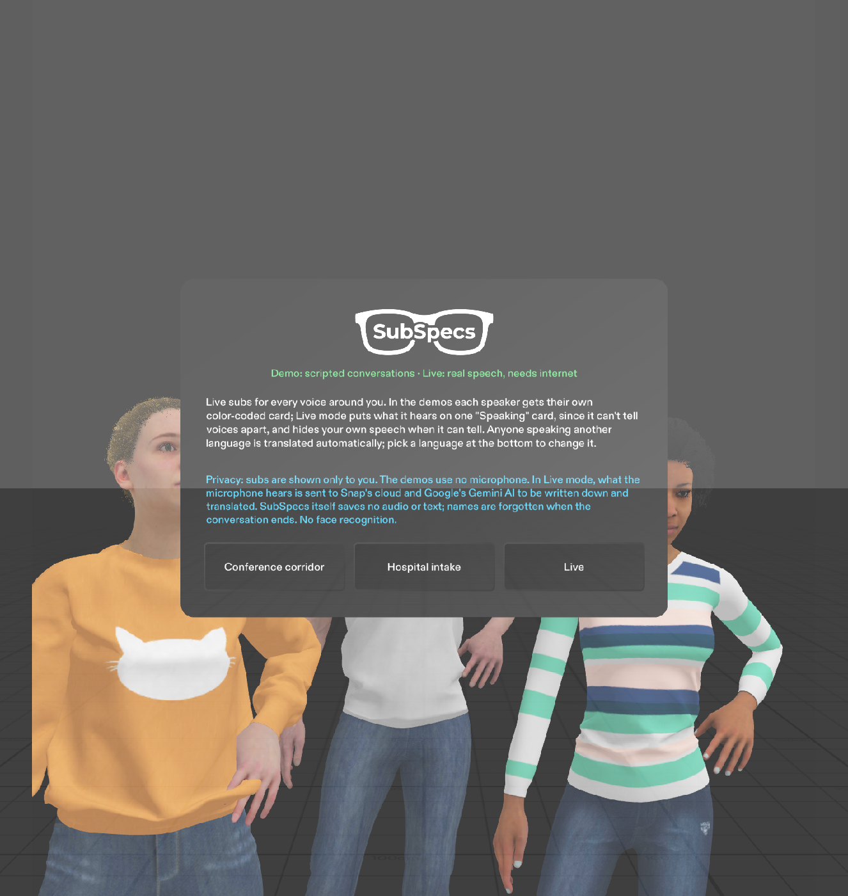

- At the founder's request, Live mode now tries to leave out the **wearer's own speech**, with
  nothing to remember to press. Nothing on the glasses can tell voices apart, so these are honest
  best guesses, and the start card says so: "hides your own speech when it can tell".
- **Loudness:** the wearer's mouth is a few centimetres from the mics, so their voice arrives much
  louder than other people's. Speech more than about 3.5 times (11 dB) louder than the usual level
  of other people is not sent to the AI at all, so it is never shown (or sent anywhere). The usual
  level is learned from the last dozen bits of others' speech, from the quieter end, after the first three.
- **Reading out reply help:** when what was heard matches a question or reply SubSpecs suggested in
  the last 30 seconds (in English or the speaker's language), the wearer is most likely reading it
  out, so it isn't shown.
- **Can miss:** someone shouting close by may be hidden, and a quiet wearer may still show. Direction
  of the voice would be better, but a Lens only gets one mixed microphone channel. A later test on
  real Specs: whether Snap's speech-to-text (which hears only the wearer) can flag the wearer's
  speech without muting everyone else's.
- **Checked:** no errors in Lens Studio's Preview, and a new test checks the two checks on their
  own, then runs Live mode with a stand-in AI and test sounds: three people at a normal level are
  shown, a much louder voice is not sent, a read-out suggestion is not shown, and the next person
  shows as usual. 19 of the 20 automated tests pass; the full-arm reach test failed 3 times (the
  simulated pinch doesn't land on the language button, as seen before in long Lens Studio sessions;
  this change doesn't touch the language bar).

---

## Nov 2, 2026: the demo people speak, and the words keep time

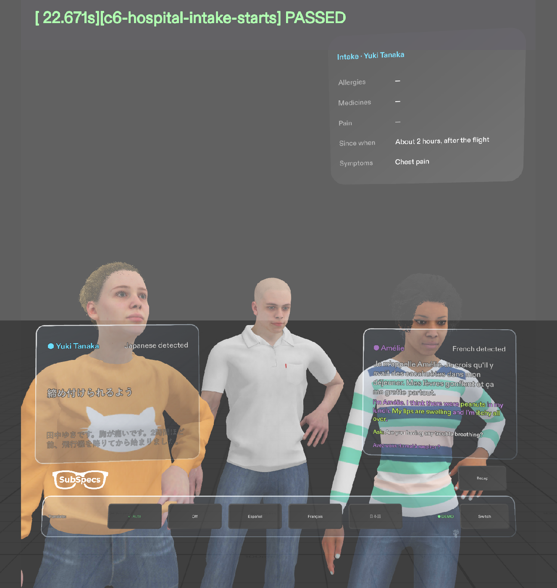

- At the founder's request, the demo conversations now have **real recorded voices**, made with
  ElevenLabs: one clip for each of the 22 lines, each in the speaker's own language. Sam (Jessica),
  Daniel (Chris), Lucía (Catalina, Spanish), Yuki Tanaka (Kiyomi, Japanese), Carlos (Adrián, Spanish)
  and Amélie (Emma, French).
- **The words keep time with the voice:** each card types its line over exactly the length of the
  clip, so the last word appears as the voice finishes.
- **No one talks over anyone:** each line starts once the voice before it has finished, plus a short
  breath, and never before its scripted time. The conversations run a few seconds longer.
- Switch stops any voice that is playing. Demo mode still uses no microphone: it only plays sound.
- **Live mode in Preview, tried for real:** SubSpecs now has its access key (kept in the local-only
  file), and with a recorded test clip as the microphone, Live mode cut the speech correctly and sent it
  to Gemini through Snap's gateway. The gateway answered every request, even a tiny text-only one, with
  status 10 ("internal error"). Snap's docs say these APIs are only available on Spectacles, so the
  real Gemini step can only be checked on glasses. The notice now says "not found", "too long" and the
  like in plain words when the gateway gives those codes.
- **Checked:** no errors in Lens Studio's Preview, and a new test checks every line has its clip, no
  two voices overlap, the voice plays while the words type and they finish together, the hospital
  voices play, and Switch stops the sound. The language test now waits for a finished line at each
  step, because with voices someone is nearly always talking. **All 19 automated tests pass.**

---

## Nov 2, 2026: Live mode, real speech on one honest card

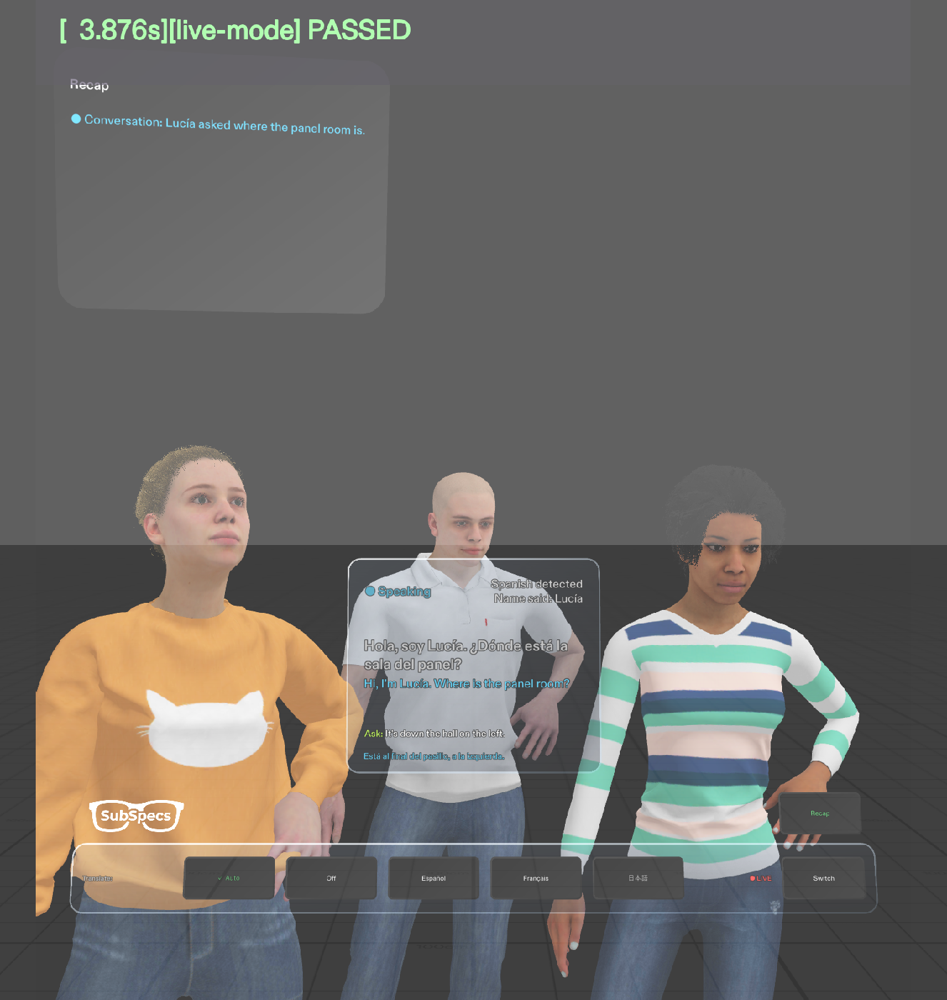

- At the founder's request, SubSpecs now has **Live mode**: a third button, **Live**, on the start card.
  It listens through the glasses' microphone, cuts the sound at the pauses, and sends each bit of speech
  to Google's Gemini through **Snap's Remote Service Gateway**, Snap's own cloud. No API key is in the
  Lens, and nothing runs on a laptop. Gemini writes down what was said, in any language, translates it
  and keeps a running summary.
- **Why not Snap's speech-to-text (AsrModule):** Snap's docs say using it turns on the glasses'
  *Bystander Speech Rejection*, which ignores speech that isn't the wearer's, the opposite of what
  SubSpecs needs. There is no setting to turn it off, so Live mode uses neither AsrModule nor VoiceML.
- **Honest about what it can't do:** nothing here can tell voices apart, so Live mode uses a single
  **"● Speaking"** card. It never says "New speaker detected" and never opens a second card. A name
  someone says shows with that line only ("Name said: Lucía"), and the recap is one line, "Conversation".
  Translation, the language tag and reply help work as in the demos.
- The bar's status now reads **● DEMO**, **● LIVE**, **● OFFLINE** (no internet: nothing is sent) or
  **● PAUSED** (a problem that needs fixing). A small notice above the bar says what's wrong in plain
  words with a code, for example "No internet. Live subs need Wi-Fi; they come back when you're online.
  (NO_INTERNET)" or "The AI service is busy. Live subs will pause for a moment. (BUSY_429)".
- **Privacy note rewritten** to be true: the demos use no microphone; in Live mode what the microphone
  hears goes to Snap's cloud and Google's Gemini AI; SubSpecs itself saves no audio or text. The old
  "Audio is never stored" is gone, because SubSpecs can't promise what Snap or Google keep.
- The access key stays off GitHub: it lives in `Assets/LocalOnly/`, which git ignores, never in the scene.
- **Checked:** no errors in Lens Studio's Preview. A new test runs Live mode with a stand-in AI and
  made-up speech sound, because the real microphone and AI service only work on the glasses. It checks
  the card, translation, name, reply help and recap, that each bit of speech is sent once with the
  summary so far, that nothing is sent without internet, the error notices, and that Switch goes back to
  Demo mode. **All 18 automated tests pass**, twice in a row (including the full-arm reach test).
- **Not checked yet:** a real conversation through Gemini. That needs Lens Studio signed in (to make the
  access key) and a test on Specs; the glasses' microphone, permission prompt and speed can only be
  checked on a real pair.

---

## Nov 2, 2026: the speaking card comes forward

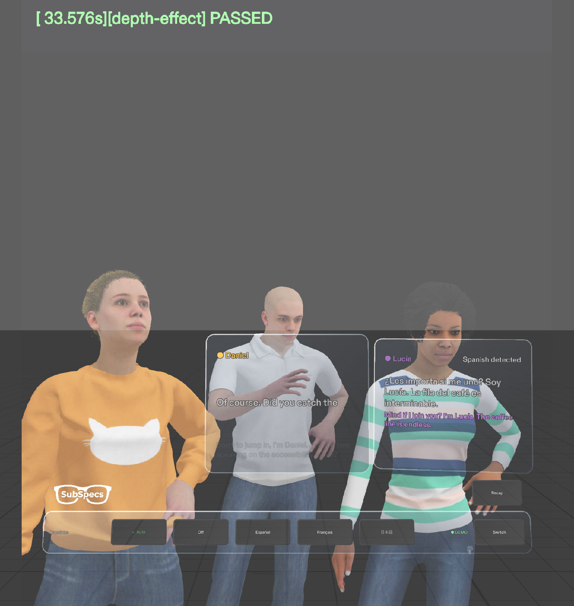

- At the founder's request, the cards now have a **depth effect**. The card of whoever is speaking
  comes about 4 cm toward the wearer and stays at full brightness. Cards of people who aren't talking
  ease back about 3 cm, and their name and words soften to 70% (still readable). It eases over about
  0.3 seconds, driven only by who is speaking.
- Cards only slide along the wearer's line of sight, so a card's place, as the wearer sees it, never
  changes. Dragging, the 3-second hold and hide-and-return work as before.
- **Checked:** no errors in Lens Studio's Preview, and a new test checks that while Sam talks, her card
  sits 4 cm nearer than its spot at full brightness, while Daniel's quiet card sits 3 cm back at 70%.
  Neither moves as seen by the wearer, and Daniel's card comes forward when he talks again. The drag,
  hold-and-return, liquid glass and named-speaker tests now compare a card's spot and color without
  the depth shift and softening. All 17 automated tests pass: 14 in the in-order run, the two
  tests adjusted for the softening on their rerun, and the full-arm reach test on a rerun, as before
  in this long Lens Studio session.

---

## Nov 2, 2026: the language bar is liquid glass too

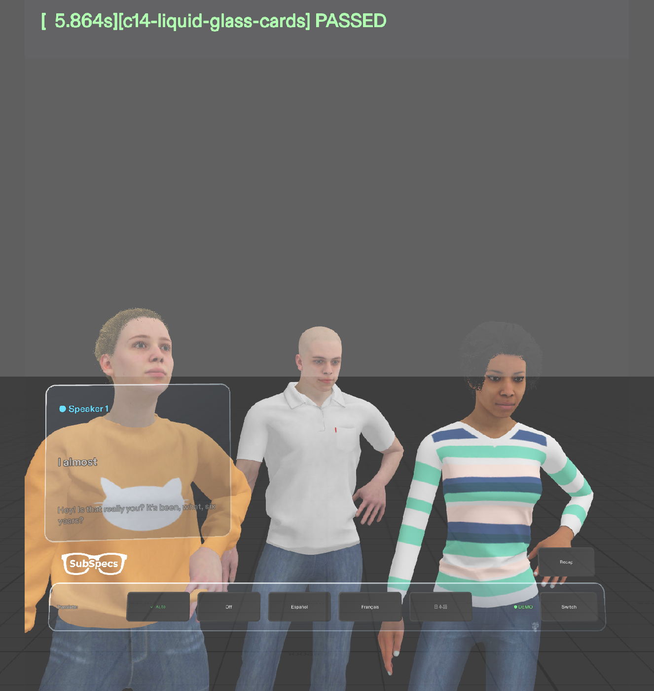

- At the founder's request, the **language bar at the bottom** now has the same liquid glass look as
  the speaker cards: the same faint tinted plate and bright rim, using the same glass code. Its
  buttons keep their faces and size; "Translate:", the button labels, "● DEMO" and Switch get the
  same soft outline as the card words; the selected language is still marked "✓" in green. Like the
  cards, it draws after the people so nobody covers it.
- **Checked:** no errors in Lens Studio's Preview; the liquid glass test now also checks the bar's
  glass, its outlined words and the green "✓ Auto". The language, Switch, Recap and full-arm reach
  tests pass (the reach test after a rerun, as before in this long Lens Studio session).

---

## Nov 2, 2026: Recap, what everyone has said so far

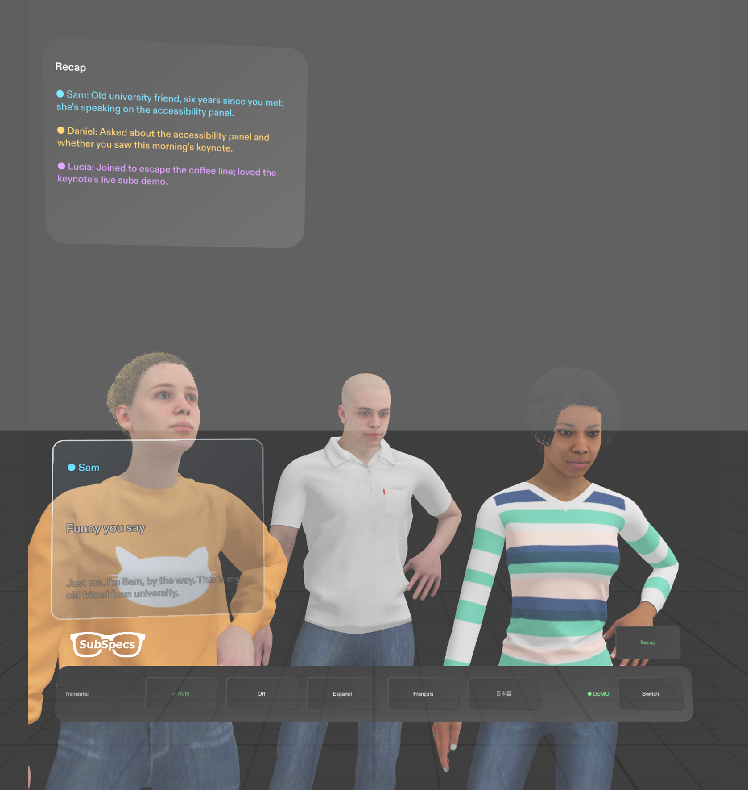

- A **Recap** button now sits just above the right end of the language bar (the SubSpecs logo sits
  above the left end). Pinching it opens a small panel in the top left of the view, above the people,
  with **one short line per speaker in their color**: "● Daniel: Asked if you two are speaking on the
  accessibility panel." Pinching it again closes it; the button turns green while it's open.
- The summaries **grow as the conversation goes**: each line someone finishes updates their summary,
  and names appear as soon as people say them. Before anyone has finished a line it says "Nothing said
  yet." Switch closes it and the next conversation starts with an empty recap.
- In the demo the summaries are pre-written for both conversations (in the hospital they read like a
  handover: "Daughter, 6, about 20 kg: fever, vomiting, lower-right stomach pain; ibuprofen 6 am"). In
  Live mode the SubSpecs server would write them; that isn't built yet.
- **Changed from the plan:** the plan put Recap on the language bar. Adding it inside the bar would
  have shrunk every language button by about 9%, so it sits just above the bar instead.
- **Checked:** no errors in Lens Studio's Preview, and a new test checks the button and panel are
  inside the view, the panel opens and closes on each pinch, each speaker gets exactly one line in
  their color, a summary grows with the speaker's next line, names show once said, and Switch empties
  it. **All 16 automated tests pass** in order, including the full-arm reach test, which worked again
  in this session.

## Nov 2, 2026: cards show a speaker's name once they say it

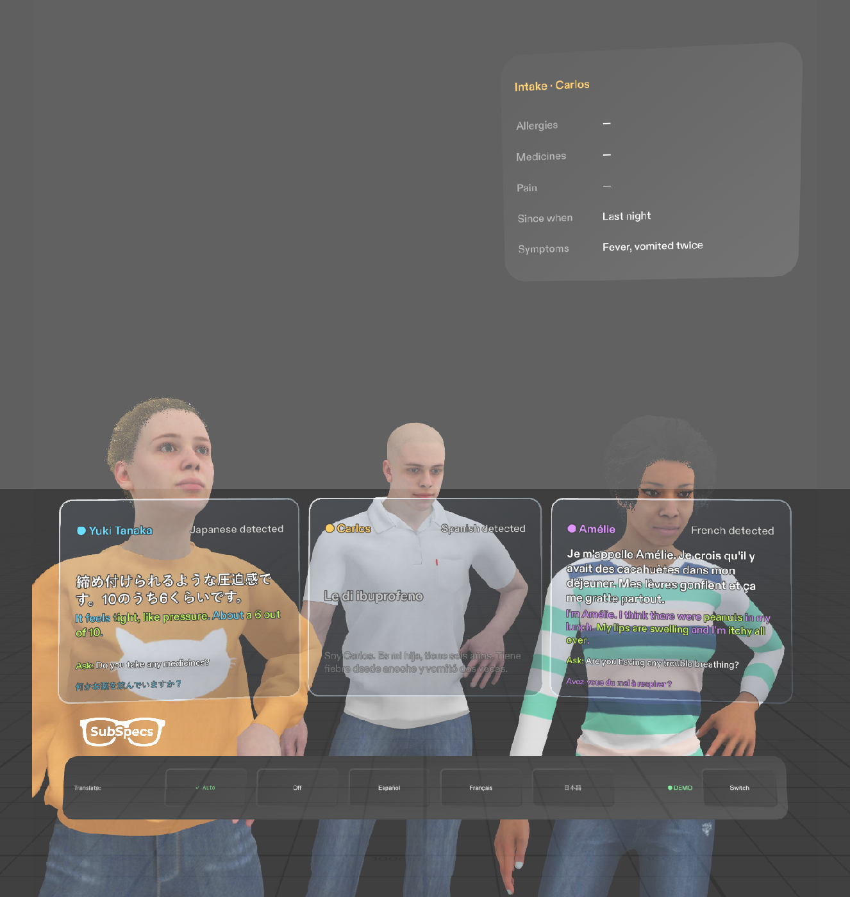

- Added at the founder's request. When someone says their name ("I'm Daniel", "Soy Lucía", "田中ゆきです"),
  their card's label changes from "● Speaker 2" to "● Daniel", in the same color, once that line is
  said. The hospital intake form uses the name too ("Intake · Amélie").
- In the demo the names are scripted into the conversations: in the corridor Daniel and Lucía introduce
  themselves, and the old friend says "I'm Sam, by the way". In the hospital each patient opens with
  their name: Yuki Tanaka (Japanese), Carlos (Spanish), Amélie (French). In Live mode the SubSpecs
  server would report a name it hears; that part isn't built yet.
- Names last only for the conversation: Switch forgets them and the cards go back to "Speaker N".
  The start card's privacy note now says so: "Speakers are numbers until they say their name, which
  is forgotten when the conversation ends. No face recognition."
- **Checked:** no errors in Lens Studio's Preview, and a new test checks Daniel's card says
  "Speaker 2" while he's talking and "Daniel" once he's said it, in his color, that Sam and Lucía get
  their names, that Switch forgets them, and that Yuki Tanaka's name shows on her card and on the
  intake form. The three-cards and start-card tests were updated for the new label and privacy note.
  14 of the 15 automated tests pass. The full-arm reach test still fails in this long Lens Studio session
  (see below).

## Nov 2, 2026: reply help, a suggested next question

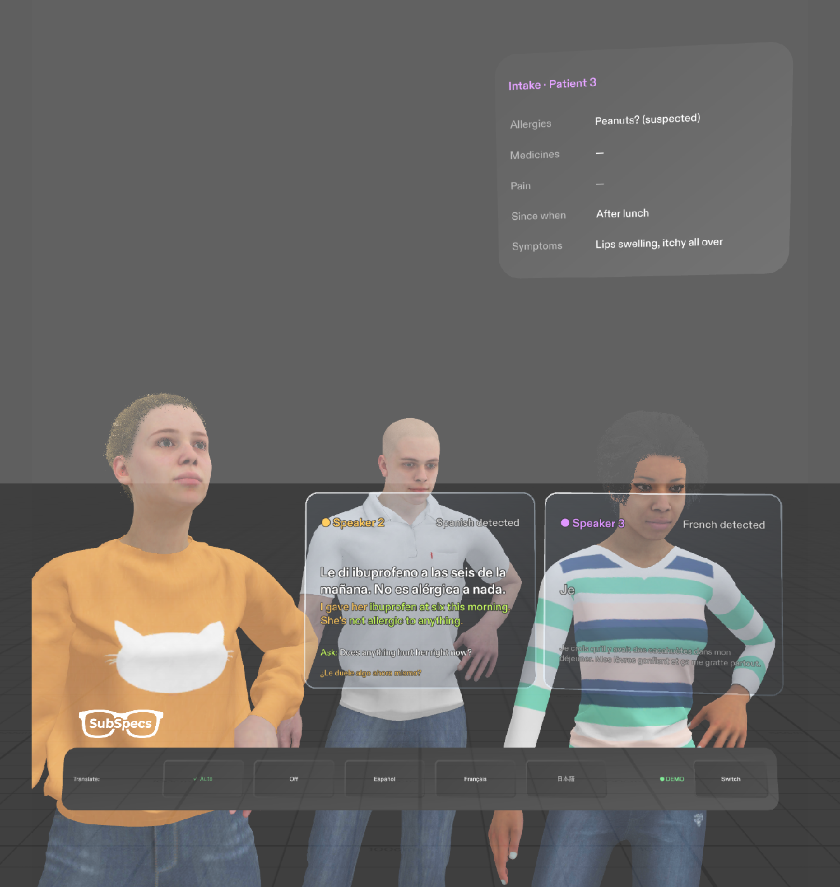

- In **Hospital intake**, once a patient finishes an answer, a **suggested next question** appears at
  the bottom of their card, under the answer: "**Ask:** Does anything hurt her right now?" in English,
  and the same question in the patient's own language underneath ("¿Le duele algo ahora mismo?"), in
  the patient's color. The wearer can read it aloud or turn the card toward the patient.
- The card stays up for 6 seconds after an answer with a question (3 seconds for everything else), so
  there's time to read it. The question goes when the card hides or the patient speaks again.
- Every one of the twelve answers has its own question, scripted to lead toward what the intake form
  still needs (for example, after the stomach pain answer it asks "How much does she weigh?").
  The corridor conversation has none.
- **Changed from the plan:** the plan put the question just under the card. Under the left card it ran
  into the SubSpecs logo above the language bar, so it sits inside the card's bottom strip instead,
  where the older line used to fade (it has always faded by the time an answer ends).
- **Checked:** no errors in Lens Studio's Preview, and a new test checks every hospital answer has a
  question in both languages, that nothing shows while the patient is still talking, that each of the
  first three answers (Japanese, Spanish, French) shows exactly its scripted question under the answer,
  and that it stays up about 6 seconds. 13 of the 14 automated tests pass. The full-arm reach test
  for the language buttons failed 5 times in this long Lens Studio session. In the same session a
  simulated pinch on a language button also did nothing, though nothing sits in front of the bar and
  the tests that press the buttons directly pass. Oct 30 looked the same, and restarting Lens Studio
  fixed it then. **Rerun it after restarting Lens Studio.**

## Nov 2, 2026: the intake form fills itself in

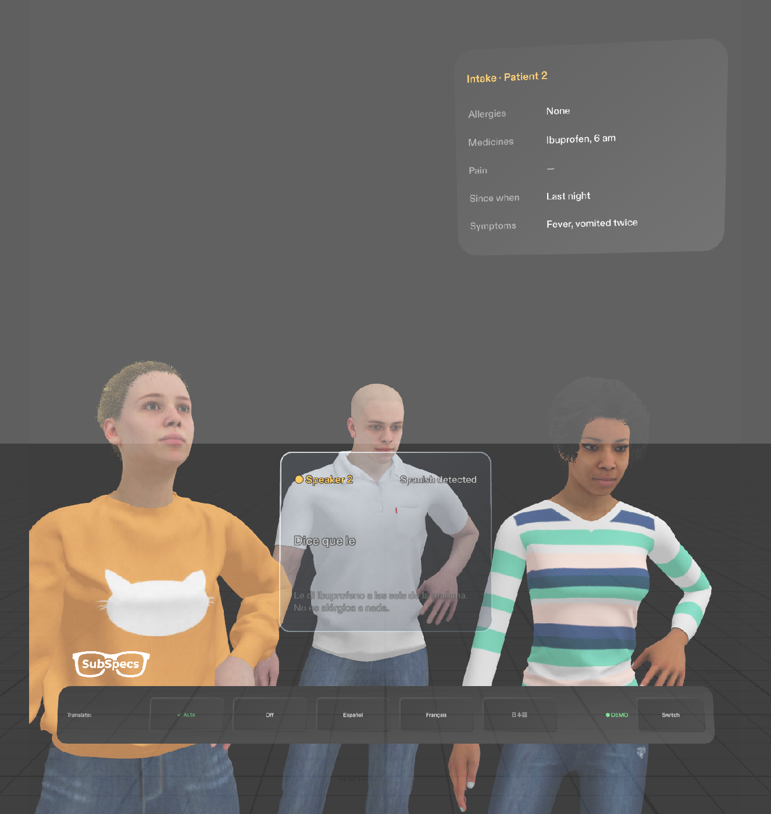

- In **Hospital intake**, a small **intake form** now sits in the top right of the view, above the
  patients' heads: Allergies, Medicines, Pain, Since when, Symptoms.
- As a patient finishes an answer, the facts highlighted in lime go straight into their form, and
  each field that fills **flashes lime** for about a second and a half. "My chest hurts... about two
  hours ago" fills Symptoms ("Chest pain") and Since when ("About 2 hours, after the flight").
- Each patient has their own form. The form shows whoever is talking now, with their number in their
  color ("Intake · Patient 2" in amber), and keeps everyone's answers when it switches.
- It only appears in the hospital scenario, and Switch hides it. When the conversation loops, the
  forms start empty again.
- **Changed from the plan:** the plan put the form beside the language bar, but the bar already
  fills the width of the view and the cards sit just above it, so there was no room there that
  didn't cover a card. It sits in the empty space above the people instead.
- **Checked:** no errors in Lens Studio's Preview, and a new test starts the hospital, checks the
  form is inside the view and above every patient's head, then checks six answers: each fills
  exactly its scripted fields the moment it's said, they flash, the flash settles, and each patient
  keeps their own form. It also checks Switch hides the form and the corridor never shows it.
  **All 13 automated tests pass** in order (the full-arm reach test failed twice first in this long
  Lens Studio session and passed after another test ran, as seen before).

## Nov 2, 2026: liquid glass speaker cards

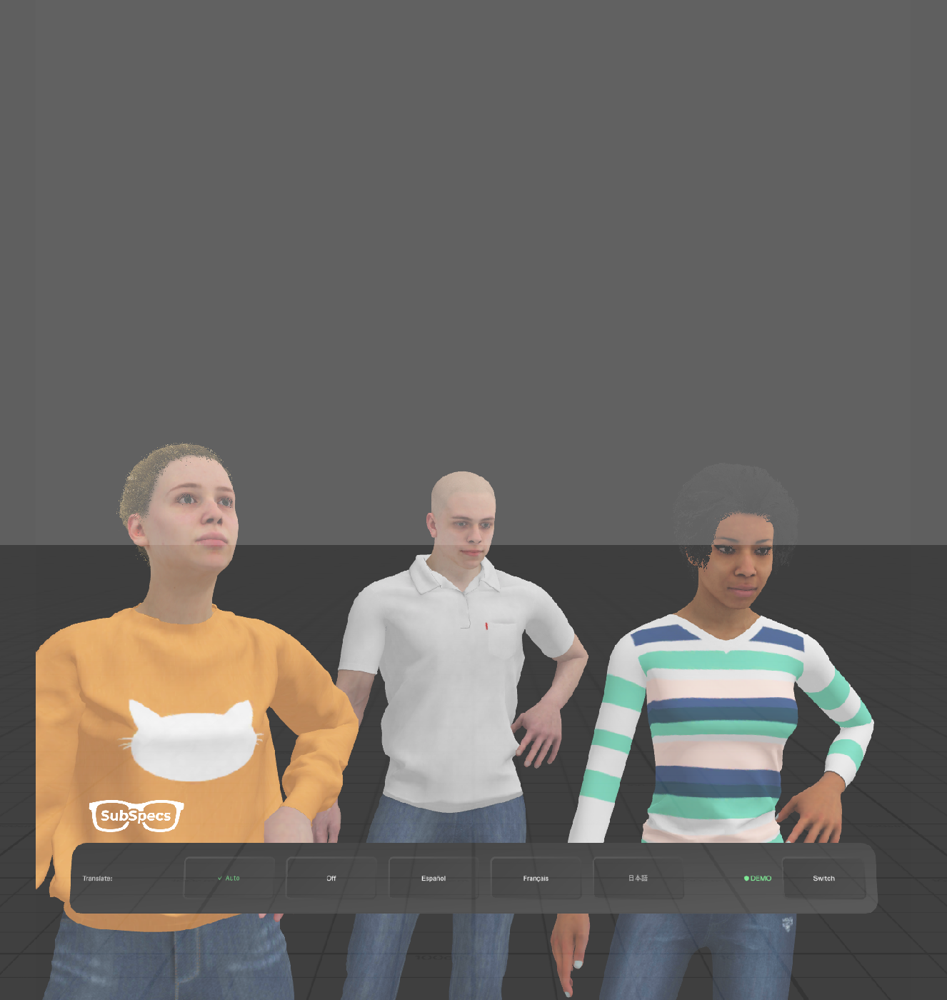

- The speaker cards now look like **liquid glass**: a very see-through plate with a faint cool tint
  (about a quarter opaque, lighter at the top left), a thin bright rim so the card's shape still reads,
  and the same rounded corners. The person behind the card stays visible through it.
- The words stay fully bright white, with a soft dark outline and shadow so they read over a busy
  background. Each speaker's color stays on their label and translation. Hovering a card makes the
  glass a touch brighter. There is no blur: SPECS can't blur the real world.
- Cards draw after the people, so a person standing behind a card never paints over its words.
- This reuses the look first tried on Oct 30 and set aside then; the founder now wants it. The start
  card and language bar are unchanged.
- **Checked:** no errors in Lens Studio's Preview, and a new test checks the plate is see-through
  (between 15% and 40% opaque) with a rim, the words are opaque white with an outline, the speaker
  label keeps its color, and hover brightens the glass. **All 12 automated tests pass** in order.

## Oct 30, 2026: a Switch button to change conversations

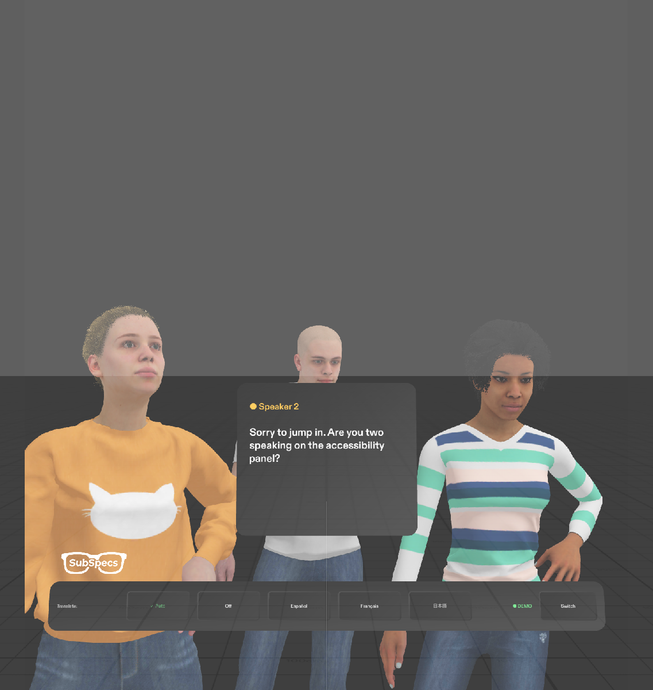

- A small **Switch** button now sits at the right end of the language bar, next to "● DEMO". Pinching
  it stops the conversation, clears every card (its words, its spot, the "New speaker detected" state
  and the older line), puts the people back to standing still, hides the language bar and brings the
  start card back in front of you. Pick **Conference corridor** or **Hospital intake** and that
  conversation starts from its first line, with no need to restart the Lens.
- The language you picked is kept across the switch.
- To make room, the bar's "Translate" label and "● DEMO" status are a little narrower, and the
  language buttons are about 4% smaller.
- **Checked:** no errors in Lens Studio's Preview, and a new test starts the corridor, picks French,
  pinches Switch, checks everything is cleared, then picks Hospital intake and checks all three
  patients start fresh with French kept. On Oct 30 the full-arm reach test for the language buttons
  failed in a long-running Lens Studio session. On Nov 2, after restarting Lens Studio, **all 11
  automated tests pass** in order. The reach test only failed when run as the very first test right
  after Lens Studio opened (the simulated arm was still settling); it passed twice more on its own.

## Oct 30, 2026: second demo, the hospital intake desk

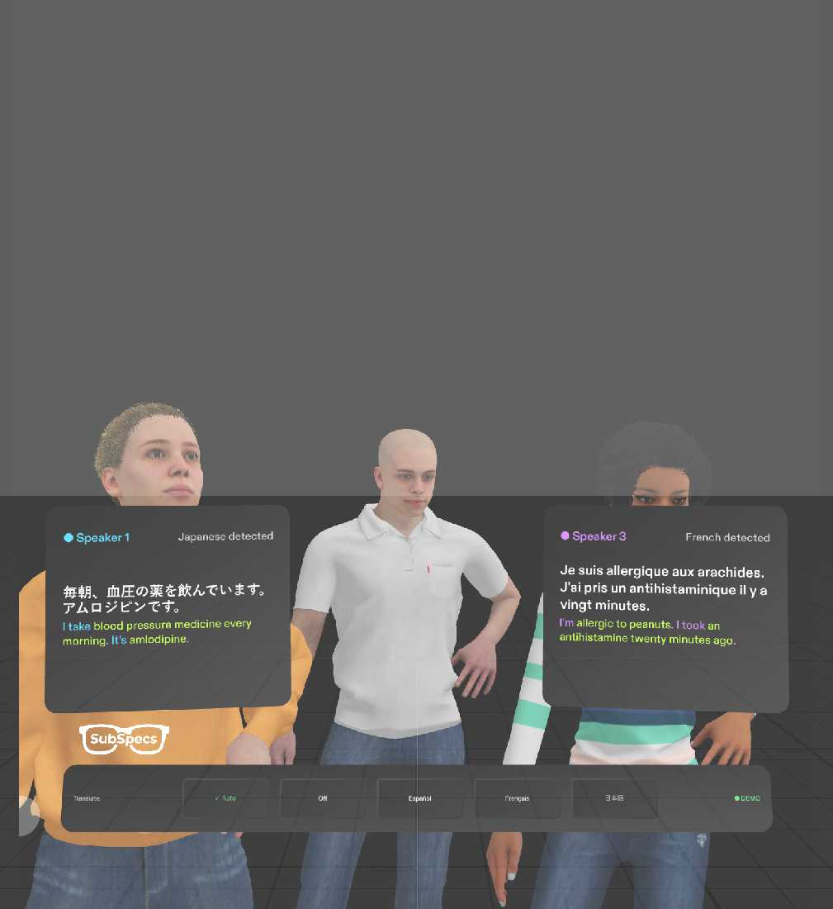

- The start card now offers two buttons, **Conference corridor** and **Hospital intake**, in place of
  Start ([screenshot](history/screenshots/2026-10-30-hospital-start-card.png)). The corridor
  conversation is unchanged.
- **Hospital intake** shows that SubSpecs helps hearing people too: the wearer works the intake desk at a
  hospital next to an international airport. The same three people are now patients: Sophie, a Japanese
  traveler with chest pain; Brian, a Spanish-speaking father describing his six-year-old daughter's fever;
  and Meghan, a French-speaking woman having a mild allergic reaction to peanuts. Twelve short answers in
  all; the worker's own questions aren't shown, because she hears them.
- Auto detects each patient's language ("Japanese detected", "Spanish detected", "French detected") and
  shows the English translation underneath.
- The facts an intake form needs (symptoms, how long, pain level, medicines, allergies, weight) show in
  **lime green** inside the English translation; the other words keep the speaker's color. Lime stands
  apart from all three speaker colors. Picking another language by hand shows the translation without
  highlights; Auto brings them back.
- Japanese subs now appear a few characters at a time as the patient speaks, like the word-by-word typing
  in the other languages.
- **Checked:** no errors in Lens Studio's Preview, and all 10 automated tests pass on the first run,
  including two new ones: the hospital button starts three patients' cards in Japanese, Spanish and French
  with English underneath, and exactly the scripted facts are highlighted on six answers.

## Oct 30, 2026: the SubSpecs logo is in the Lens

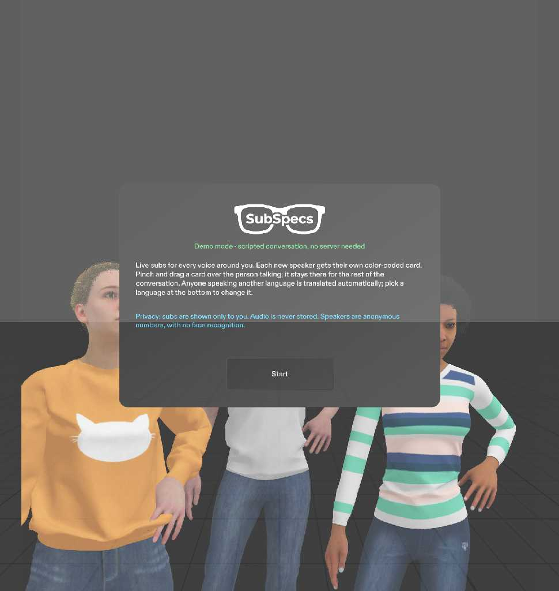

- The white SubSpecs logo now replaces the "SubSpecs" title at the top of the start card.
- Once you press Start, a small copy sits just above the left end of the language bar, so the name
  stays in view without getting in the way of the subs
  ([screenshot](history/screenshots/2026-10-30-logo-in-view.png)). It is about 4 cm wide at 60 cm away,
  well inside the glasses' view, readable and the right way round.
- The logo is drawn white and unlit, because SPECS glasses add light: black would be invisible.
- **Checked:** no errors in Lens Studio's Preview, and all 8 automated tests pass. The language-picker
  reach test missed the French button once (the simulated hand was slow to settle, a known flaky miss
  unrelated to the logo) and passed on its rerun.

## Oct 30, 2026: on GitHub, with a README and this history page

- The project now lives in a private GitHub repository with its full history from the first commit.
- Added the README (what SubSpecs does, status, how to try it) and this history page.

## Oct 30, 2026: logo and name spelling (logo not hooked up yet)

- The founder's SubSpecs logo arrived (`Assets/Branding/SubSpec Transparent PNG.png`, black glasses
  with "SubSpecs" inside).
- **Why a white copy:** SPECS glasses add light to what you see, so black shows as see-through. The
  black logo would be invisible on the glasses and on the dark cards. A white copy, trimmed to the
  glasses, was made: `Assets/Branding/SubSpecsLogo_White.png`. The original is kept.
- Code written for the logo to replace the "SubSpecs" title on the start card and to sit small above
  the language bar during the conversation. Not yet hooked up in Lens Studio or tested.
- The name is now spelled **SubSpecs** (two capital S's) everywhere people see it.

## Oct 30, 2026: real-looking people replace the grey stand-ins ([`4116491`](../../commit/4116491))

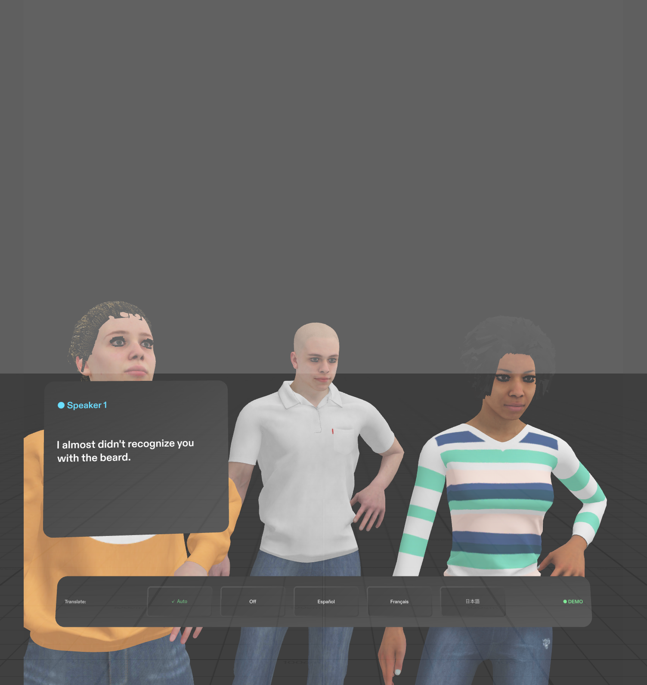

- Three Mixamo people now stand in for the conversation: **Sophie** (speaker 1, the old friend),
  **Brian** (speaker 2) and **Meghan** (speaker 3, who speaks Spanish).
- They stand at different distances (about 2.4, 3.6 and 2.8 m) with a gap between each, so they never
  overlap or blend into each other in the wearer's narrow view.
- Each person plays a Talking animation only while their subs are appearing, and stands naturally
  otherwise. (At first, quiet people snapped into a stiff arms-out "T-pose"; fixed by holding the first
  frame of the animation.)
- Textures shrunk from 4096 px to 1024 px so the glasses stay smooth. About 144,500 triangles in all.
- The drag test now aims at Sophie's head, and a new test checks that a person talks only while their
  speaker is speaking.
- **Checked:** all 8 automated tests pass in Lens Studio's Preview.
- These people exist only for the demo and video. The real app captions real people, with no models.

## Oct 30, 2026: plan for the demo people ([`433e2f6`](../../commit/433e2f6))

- Notes that the Mixamo people (Sophie, Brian, Meghan) will be committed on purpose so judges see them.

## Oct 29, 2026: the name becomes SubSpecs ([`f85ef29`](../../commit/f85ef29))

- The app was renamed from "Caption" to SubSpecs, and the feature from "captions" to **subs**, in
  everything people see. Internal code names keep "Caption" so nothing breaks in Lens Studio or the
  server.

## Oct 29, 2026: how Live mode avoids pointless translation ([`b293905`](../../commit/b293905))

- Notes that in Live mode the SubSpecs server skips translating subs that are already in the wearer's
  chosen language.

## Oct 29, 2026: Auto translation ([`ac934e2`](../../commit/ac934e2))

- New default setting, **Auto**: subs stay in the wearer's language, and when someone speaks another
  language their card shows a "Spanish detected" tag with the English translation underneath.
- Picking a language by hand translates everyone into it; pinching Auto brings detection back.
- **Checked:** a new automated test, `auto-detect-language`, passes.

## Oct 29, 2026: Demo mode checked in Preview ([`ed52a13`](../../commit/ed52a13))

- All five done criteria from the design brief pass as automated tests (LEAF) in Lens Studio's
  Preview: three voices make three color-coded cards; a card can be dragged over a person and stays
  there; cards hide about 3 s after the speaker stops and come back in the same spot; switching
  language updates recent lines; the start card explains the app and the privacy note.
- **Fixed along the way:** cards and figures were outside the glasses' narrow view (about 32 degrees
  wide) and were moved in; grey figures showed a magenta checkerboard (missing texture) and got plain
  materials; dragging a card could fling it at the wearer's face; the language bar's background caught
  pinches meant for its buttons.
- The test tools were made for a newer Interaction Kit and were adapted to the installed one.

## Oct 29, 2026: Demo mode built ([`972eb57`](../../commit/972eb57))

- A scripted three-person corridor conversation plays on its own, with no server needed.
- One card per speaker: its own color and number, words appearing as they are spoken, the previous
  line fading below, a "New speaker detected" label, and pre-written Spanish, French and Japanese
  translations.
- A language bar at the bottom of the view and a start card with the privacy note and a Start button.
- Three simple grey stand-in figures mark where the speakers stand.

## Oct 29, 2026: large files go through Git LFS ([`2a4571c`](../../commit/2a4571c))

- Lens Studio's own git settings adopted; images, models and packages are stored with Git LFS so the
  repository stays fast.

## Oct 29, 2026: project started ([`d8b4541`](../../commit/d8b4541))

- New Lens Studio project from the SPECS Base Template.
- The design brief was written and approved: what the app does, what the preview can and can't show,
  and the five done criteria.
- A small bridge (`tools/ls-mcp-bridge.js`) lets Claude Code talk to Lens Studio reliably, working
  around a bug in how Lens Studio 5.24.1 sends its replies.
- Secret files (tokens, keys, local settings) are kept out of the repository from the first commit.
