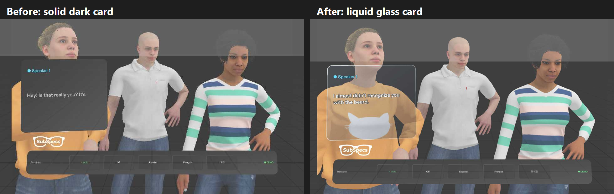

# SubSpecs: project history

SubSpecs is a Lens for Snap's SPECS glasses: live subs for every voice around you, one color-coded
card per speaker, with translation, for people who are deaf or hard of hearing. Built for the
**Learn AR with SPECS** Devpost hackathon (deadline Nov 9, 2026).

This page is the story of the build, newest first. Each entry says what changed, why, and how it was
checked, with the commit it landed in and a Lens Studio screenshot when there is one. Screenshots live
in `history/screenshots/` (and `devpost/screenshots/`). The detailed engineering notes are in
[`devpost/build-progress.md`](devpost/build-progress.md); the plan is in
[`devpost/design-brief.md`](devpost/design-brief.md).

---

## Oct 30, 2026: speaker cards become "liquid glass"

- The speaker cards are now like a sheet of glass instead of a solid dark panel: very see-through, with
  a slight cool tint, a soft light sheen at the top left, and a thin bright edge so you can still see
  the card's shape. Corners stay rounded. Hovering over a card makes it a touch brighter.
- **Why:** subs should never block the person you are talking to. On the glasses the dark panel was
  already see-through, but in Preview and in the demo video it hid people. Now Sophie, her sweater and
  her hands show clearly through her card.
- The words stay solid white, with a soft dark edge and shadow so they are easy to read even over a
  bright, busy background. Each speaker's color stays on their label and dot.
- There is no blur behind the card: SPECS cannot blur the real world, and it would slow the glasses down.
- Fixed along the way: with a see-through card, the people could be drawn on top of the words. The
  cards are now drawn last, so the words are always in front.
- The start card and language bar are unchanged.
- **Checked:** no errors in Lens Studio's Preview, and all 8 automated tests pass on the first try.

## Oct 30, 2026: the SubSpecs logo is in the Lens

- The white SubSpecs logo now replaces the "SubSpecs" title at the top of the start card.
- Once you press Start, a small copy sits just above the left end of the language bar, so the name
  stays in view without getting in the way of the subs
  ([screenshot](history/screenshots/2026-10-30-logo-in-view.png)). It is about 4 cm wide at 60 cm away,
  well inside the glasses' view, readable and the right way round.
- The logo is drawn white and unlit, because SPECS glasses add light: black would be invisible.
- **Checked:** no errors in Lens Studio's Preview, and all 8 automated tests pass. The language-picker
  reach test missed the French button once (the simulated hand was slow to settle, a known flaky miss
  unrelated to the logo) and passed on its rerun.

## Oct 30, 2026: on GitHub, with a README and this history page

- The project now lives in a private GitHub repository with its full history from the first commit.
- Added the README (what SubSpecs does, status, how to try it) and this history page.

## Oct 30, 2026: logo and name spelling (logo not hooked up yet)

- The founder's SubSpecs logo arrived (`Assets/Branding/SubSpec Transparent PNG.png`, black glasses
  with "SubSpecs" inside).
- **Why a white copy:** SPECS glasses add light to what you see, so black shows as see-through. The
  black logo would be invisible on the glasses and on the dark cards. A white copy, trimmed to the
  glasses, was made: `Assets/Branding/SubSpecsLogo_White.png`. The original is kept.
- Code written for the logo to replace the "SubSpecs" title on the start card and to sit small above
  the language bar during the conversation. Not yet hooked up in Lens Studio or tested.
- The name is now spelled **SubSpecs** (two capital S's) everywhere people see it.

## Oct 30, 2026: real-looking people replace the grey stand-ins ([`d3fc4e0`](../../commit/d3fc4e0))

- Three Mixamo people now stand in for the conversation: **Sophie** (speaker 1, the old friend),
  **Brian** (speaker 2) and **Meghan** (speaker 3, who speaks Spanish).
- They stand at different distances (about 2.4, 3.6 and 2.8 m) with a gap between each, so they never
  overlap or blend into each other in the wearer's narrow view.
- Each person plays a Talking animation only while their subs are appearing, and stands naturally
  otherwise. (At first, quiet people snapped into a stiff arms-out "T-pose"; fixed by holding the first
  frame of the animation.)
- Textures shrunk from 4096 px to 1024 px so the glasses stay smooth. About 144,500 triangles in all.
- The drag test now aims at Sophie's head, and a new test checks that a person talks only while their
  speaker is speaking.
- **Checked:** all 8 automated tests pass in Lens Studio's Preview.
- These people exist only for the demo and video. The real app captions real people, with no models.

## Oct 30, 2026: plan for the demo people ([`335ec36`](../../commit/335ec36))

- Notes that the Mixamo people (Sophie, Brian, Meghan) will be committed on purpose so judges see them.

## Oct 29, 2026: the name becomes SubSpecs ([`d0d649b`](../../commit/d0d649b))

- The app was renamed from "Caption" to SubSpecs, and the feature from "captions" to **subs**, in
  everything people see. Internal code names keep "Caption" so nothing breaks in Lens Studio or the
  server.

## Oct 29, 2026: how Live mode avoids pointless translation ([`267d46e`](../../commit/267d46e))

- Notes that in Live mode the SubSpecs server skips translating subs that are already in the wearer's
  chosen language.

## Oct 29, 2026: Auto translation ([`9ab57ac`](../../commit/9ab57ac))

- New default setting, **Auto**: subs stay in the wearer's language, and when someone speaks another
  language their card shows a "Spanish detected" tag with the English translation underneath.
- Picking a language by hand translates everyone into it; pinching Auto brings detection back.
- **Checked:** a new automated test, `auto-detect-language`, passes.

## Oct 29, 2026: Demo mode checked in Preview ([`782b0b0`](../../commit/782b0b0))

- All five done criteria from the design brief pass as automated tests (LEAF) in Lens Studio's
  Preview: three voices make three color-coded cards; a card can be dragged over a person and stays
  there; cards hide about 3 s after the speaker stops and come back in the same spot; switching
  language updates recent lines; the start card explains the app and the privacy note.
- **Fixed along the way:** cards and figures were outside the glasses' narrow view (about 32 degrees
  wide) and were moved in; grey figures showed a magenta checkerboard (missing texture) and got plain
  materials; dragging a card could fling it at the wearer's face; the language bar's background caught
  pinches meant for its buttons.
- The test tools were made for a newer Interaction Kit and were adapted to the installed one.

## Oct 29, 2026: Demo mode built ([`3f96e8e`](../../commit/3f96e8e))

- A scripted three-person corridor conversation plays on its own, with no server needed.
- One card per speaker: its own color and number, words appearing as they are spoken, the previous
  line fading below, a "New speaker detected" label, and pre-written Spanish, French and Japanese
  translations.
- A language bar at the bottom of the view and a start card with the privacy note and a Start button.
- Three simple grey stand-in figures mark where the speakers stand.

## Oct 29, 2026: large files go through Git LFS ([`8d87eb6`](../../commit/8d87eb6))

- Lens Studio's own git settings adopted; images, models and packages are stored with Git LFS so the
  repository stays fast.

## Oct 29, 2026: project started ([`907925a`](../../commit/907925a))

- New Lens Studio project from the SPECS Base Template.
- The design brief was written and approved: what the app does, what the preview can and can't show,
  and the five done criteria.
- A small bridge (`tools/ls-mcp-bridge.js`) lets Claude Code talk to Lens Studio reliably, working
  around a bug in how Lens Studio 5.24.1 sends its replies.
- Secret files (tokens, keys, local settings) are kept out of the repository from the first commit.
