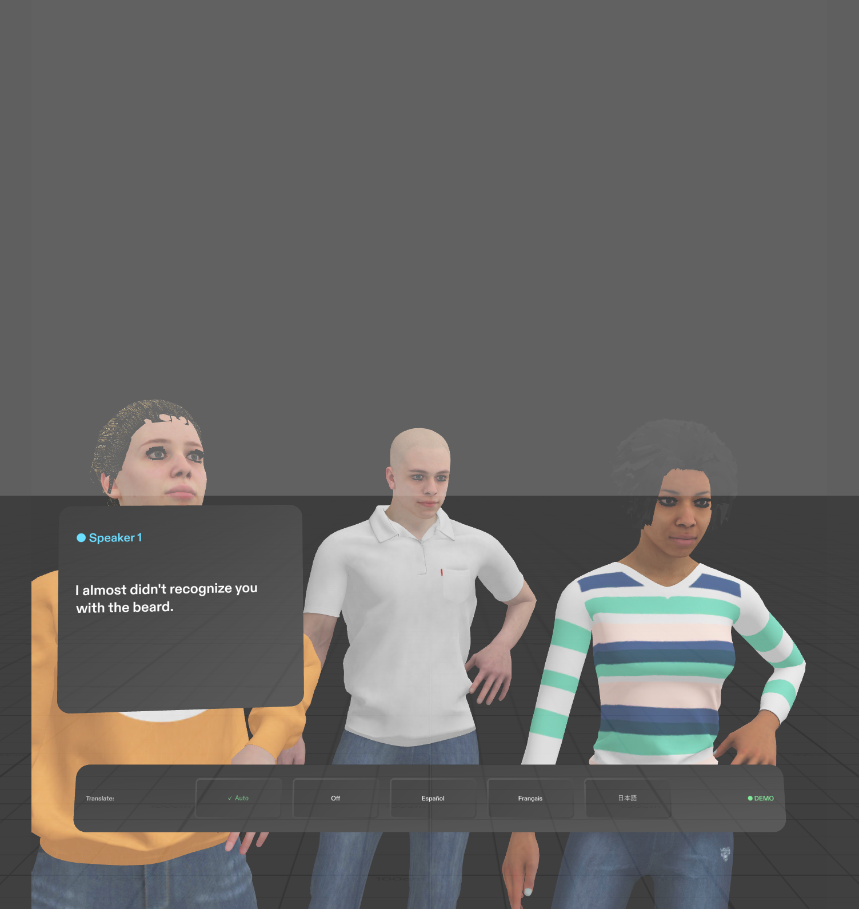

# SubSpecs

Live, color-coded subs for every voice around you on Snap's SPECS AR glasses, with real-time
translation, for people who are deaf or hard of hearing. Built in Lens Studio for the
**Learn AR with SPECS** Devpost hackathon.

## What it does

- **One card per voice.** Each new speaker gets their own color-coded card, and their words appear as
  they speak, with the previous line fading below.
- **Put the words where the person is.** Pinch and drag a card over the person talking; it stays there
  for the rest of the conversation, so you can read while keeping eye contact.
- **Translation.** On Auto, anyone speaking another language is detected and translated into yours.
  Or pick a language at the bottom of the view to translate everyone.
- **Private by design.** Subs are shown only to the wearer, audio is never stored, and speakers are
  anonymous numbers with no face recognition.

## Status

**Demo mode** is built and checked: a scripted three-person conversation plays with no server, so
anyone can try it. All 8 automated tests (LEAF) pass in Lens Studio's Preview. The three people in
the demo are Mixamo stand-ins used only for the demo and video; the real app captions real people.

**Live mode** (streaming the glasses' audio to the SubSpecs server for real speech recognition and
translation) is not built yet.

## Try it

1. Open `CaptionSpecs.esproj` in Lens Studio 5.24 or later. (Internal names still use the project's
   first name, "Caption".)
2. In the Preview panel, pinch **Start** on the start card.
3. Watch the conversation; drag a card over a person; try the language buttons.

Large files (models, textures, packages) are stored with Git LFS: install it before cloning.

## More

- [Project history](HISTORY.md): every step of the build, with screenshots.
- [Design brief](devpost/design-brief.md): the plan and the done criteria.
- [Build notes](devpost/build-progress.md): detailed engineering notes and test results.
